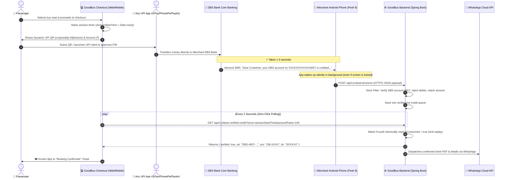

# GoodBus — Automated UPI Payment Confirmation Engine (How It Works)

GoodBus provides an **instant, zero-click, zero-fee UPI payment gateway**. 
Instead of paying 2%–3% commission fees to traditional aggregators (Razorpay, Cashfree, Paytm Gateway) or forcing customers to manually copy-paste a 12-digit bank reference (UTR), GoodBus uses an **automated Android Banking Observer**.

---

## 🌟 The High-Level Idea (In 30 Seconds)

1. **Customer pays via UPI**: Customer scans the QR code or clicks "Pay with UPI" using GPay, PhonePe, Paytm, or CRED.
2. **Bank notifies merchant**: DBS Bank sends an SMS to the merchant's Android phone (Pixel 9):
   > *"Dear Customer, your DBS account no XXXXXXXXXXXX4657 is credited with INR 1.00 on 28-Oct-2026..."*
3. **Android app catches SMS**: The **Mitto Pay SMS Gateway** app on the merchant phone reads the SMS in the background and sends it to the server in under 1 second.
4. **Server verifies & confirms**: The backend verifies that the payment was credited to account `4657` with the exact ticket fare.
5. **Ticket appears instantly**: The checkout screen detects the verification and flips directly to the **Booking Confirmed** screen. No manual entry needed!

---

## 🔄 End-to-End Visual Flow



---

## 🧩 The 3 Core Components

### 1. Frontend: Passenger Checkout (`PaymentScreen.tsx`)
* **What it does**:
  * Displays the merchant UPI ID (`cmporeddy-9@okaxis`) with a dynamic single-use QR code.
  * Captures the exact moment the screen opened (`sessionStartTime = Date.now()`).
  * Runs a background loop every 2 seconds querying `/api/v1/latest-verified-credit`.
  * As soon as the server verifies the payment, it automatically transitions the passenger to the ticket screen.
  * **Fallback**: It still retains a manual UTR input field in case SMS delivery is delayed by the telecom operator.

### 2. Mobile: Android Background Observer (`Mitto Pay SMS Gateway` APK)
* **What it does**:
  * Installed on the merchant's Android phone (e.g. Google Pixel 9) containing the SIM registered with DBS Bank.
  * Uses Android's high-priority `SMS_RECEIVED` broadcast receiver.
  * **Runs 24/7 in the background**: You can close the app or lock the phone. As long as battery optimization is set to **"Unrestricted"**, it wakes up instantly on every incoming bank SMS.
  * Forwards the SMS content over secure HTTPS to the backend:
    `POST https://beta-goodbus.apexarblabs.com/api/v1/observers/sms`

### 3. Backend: Spring Boot Gateway (`AndroidObserverController.java`)
* **What it does**:
  * Receives the raw SMS from the phone.
  * Applies **4 strict security filters** (see below).
  * Enqueues verified payments in memory.
  * When the frontend polls, it atomically binds the credit to the customer's `orderId` and marks it **consumed** so it can never be used again.
  * Issues the ticket PNR/TIN and triggers the WhatsApp confirmation.

---

## 🛡️ Security Rules & Anti-Fraud Protection

To ensure total accuracy and prevent false confirmations, four strict rules are enforced:

### Rule 1: DBS Account Locking (Account Ending in `4657`)
* **Only SMS credited to the merchant's specific DBS account ending in 4657 are accepted**.
* **Regex applied**:
  ```regex
  (?i)(?:your\s+)?DBS\s+account\s+(?:no\.?|number)?\s*[X*x]*4657\s+is\s+credited\s+with\s+(?:INR|Rs\.?|₹)?\s*([0-9,]+(?:\.[0-9]{1,2})?)
  ```
* **Sample Accepted SMS**:
  > *"Dear Customer, your DBS account no XXXXXXXXXXXX4657 is credited with INR 1.00 on 28-Oct-2026 and is subject to clearance. Current Balance is INR 8559.24."*
* **Rejected Messages**:
  * SMS from other banks (SBI, HDFC, ICICI, Federal Bank, Axis, etc.) are rejected with `REJECTED_NON_MERCHANT_DBS`.
  * SMS for any other DBS account (not ending in `4657`) are rejected.

### Rule 2: Strict Debit SMS Rejection
* When the merchant makes a payment from their own phone, their phone receives a **DEBIT** alert (e.g. *"Debited Rs 1.00 from Federal Bank..."*).
* A debit is money **leaving** an account. The server immediately detects words like `debited`, `withdrawn`, `spent` and ignores them (`IGNORED_DEBIT`).

### Rule 3: Exact Fare Matching
* The credited amount in the SMS must exactly match the ticket price in paise (`amountPaise`).
* If a ticket costs ₹499, a ₹1 payment will **never** confirm it.
* The balance statement at the end of the SMS (e.g. `Current Balance is INR 8559.24`) is strictly ignored; only the amount following `credited with INR` is extracted.

### Rule 4: Anti-Replay & Atomic Single-Use Consumption
* **Time Bound**: A credit is only valid if it arrived **after** the customer opened the checkout screen (`observedAt >= sessionStartTime - 3000ms`). Old credits from yesterday or minutes ago are ignored.
* **Single-Use**: Once a credit confirms a booking:
  ```java
  obs.isConsumed = true;
  obs.consumedByOrderId = targetOrderId;
  ```
  It is flagged as consumed. It can **never** trigger another booking.

---

## ❓ Frequently Asked Questions (FAQ)

### Q: Does the Android app need to be open on my screen?
**No.** You can close the app, lock your phone, or use other apps. The Android OS triggers the app's background service whenever an SMS arrives. Just ensure **Battery Optimization** for the app is set to **"Unrestricted"**.

### Q: Can someone else's payment confirm my ticket?
**No.** The passenger's screen only looks for payments that arrived **during** their active 5-minute checkout session with their **exact fare amount**. Once matched, the credit is immediately consumed.

### Q: What if the SMS is delayed by the mobile network?
If DBS Bank or telecom SMS is delayed, the customer can still enter their 12-digit UPI reference (UTR) in the manual fallback box on the checkout screen and click **"Verify & Confirm"**.

---

| Method | Endpoint | Description |
| :--- | :--- | :--- |
| `POST` | `/api/v1/pollers/android/pair` | Pairs the Android phone with enrollment token |
| `POST` | `/api/v1/observers/sms` | Ingests bank SMS from Android background service |
| `GET` | `/api/v1/latest-verified-credit` | Frontend auto-polling endpoint with atomic consumption |
| `POST` | `/busticket/api/v1/payment/verify-utr` | Fallback endpoint for manual 12-digit UTR submission |
| `GET` | `/api/v1/active-payment-config` | Public endpoint returning active receiving UPI VPA & Merchant Name |
| `GET` | `/api/v1/admin/bank-accounts` | Lists all configured bank profiles and active status |
| `POST` | `/api/v1/admin/bank-accounts` | Creates a new bank account & UPI profile |
| `PUT` | `/api/v1/admin/bank-accounts/{id}` | Updates existing bank account profile |
| `DELETE`| `/api/v1/admin/bank-accounts/{id}` | Deletes bank account profile |
| `POST` | `/api/v1/admin/bank-accounts/{id}/activate`| Switches the active payment gateway profile |
| `POST` | `/api/v1/admin/test-sms` | Validates a test credit SMS against bank regex rules |

---

## 🎛️ Dynamic Admin Panel (Bank & UPI Management)

The Admin Panel is live at:
**[https://beta-goodbus.apexarblabs.com/admin](https://beta-goodbus.apexarblabs.com/admin)** (or click **Admin** in the top navigation bar).

From this panel, you can:
1. **Add Any Bank Account**: Enter Bank Name (HDFC, SBI, ICICI, DBS, etc.), Account Number, and UPI ID.
2. **Auto-Generate Regex from Sample SMS**: Paste a real bank credit SMS and let the system auto-generate the matching regex.
3. **One-Click Switch Active Gateway**: Select any profile as the active gateway. The checkout QR code and observer regex update instantly!
4. **Live SMS Simulator**: Test any SMS directly in the browser to ensure the parser extracts the exact fare and reference.

