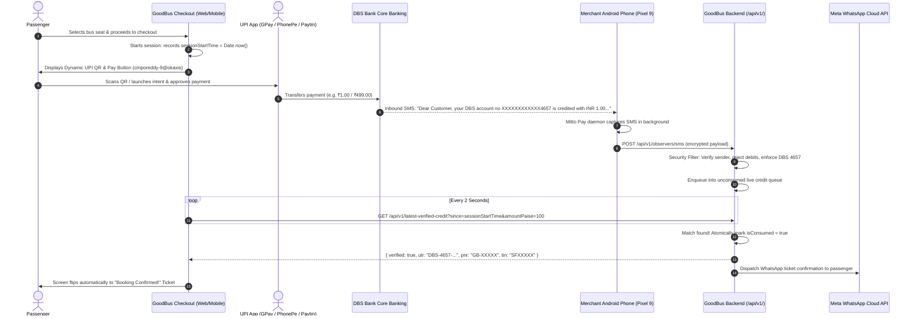

# YouPI PG V2 — Real-Time DBS Bank UPI Observation & Auto-Confirmation Engine

This document provides a comprehensive technical walkthrough of how the **YouPI Banking SMS Observer**, **Android Gateway App**, and **GoodBus Checkout Engine** work together to achieve instant, zero-click ticket confirmations without third-party aggregator gateway fees.

---

## 1. High-Level Architecture & Lifecycle



---

## 2. Core System Components

### A. Android Background Observer (`Mitto Pay SMS Gateway` APK)
* **Package**: `com.youpi.observer`
* **Installed on**: Merchant's Android device (Pixel 9) holding the bank SIM card.
* **Key Daemons**:
  * `SmsReceiver`: High-priority broadcast receiver (`android.provider.Telephony.SMS_RECEIVED`). Wakes up silently when an SMS arrives, even when the phone screen is off or the app is closed.
  * `ForegroundService`: Sticky persistent service with low-priority notification ensuring Android's battery manager doesn't kill the background process.
  * `ApiClient`: Cryptographically transmits captured bank notifications over TLS (HTTPS) to the server.

### B. Gateway Controller (`AndroidObserverController.java`)
* **Endpoint Base**: `/api/v1/`
* **Context**: Spring Boot embedded in `busticket.jar` on port 8085.
* **Responsibilities**:
  1. Pairing & authenticating the Android device.
  2. Parsing and filtering incoming SMS broadcasts.
  3. Managing the live in-memory `CreditObservation` queue.
  4. Serving frontend polling queries with atomic single-use credit consumption.

### C. Checkout Screen (`PaymentScreen.tsx`)
* **Context**: Vite + React Single Page Application (`goodbus-ui`).
* **Responsibilities**:
  1. Renders the dynamic single-use UPI QR code and native `upi://pay` deep link.
  2. Initializes `sessionStartTime = Date.now()` when the checkout screen mounts.
  3. Auto-polls `/api/v1/latest-verified-credit` every 2 seconds.
  4. Instantly transitions the UI to the confirmed ticket state upon credit detection without requiring manual UTR entry.

---

## 3. Strict Security & Attribution Invariants

To eliminate false confirmations, replay attacks, and foreign bank alerts, the system enforces four mandatory layers of security:

### 1. Merchant Account & Bank Locking
Only messages matching the merchant's exact DBS Bank format are accepted:
```regex
(?i)(?:your\s+)?DBS\s+account\s+(?:no\.?|number)?\s*[X*x]*4657\s+is\s+credited\s+with\s+(?:INR|Rs\.?|₹)?\s*([0-9,]+(?:\.[0-9]{1,2})?)
```
* **Sample Accepted SMS**:
  > *"Dear Customer, your DBS account no XXXXXXXXXXXX4657 is credited with INR 1.00 on 28-Oct-2026 and is subject to clearance. Current Balance is INR 8559.24."*
* **Foreign Bank Alerts Discarded**:
  * Alerts from SBI, HDFC, ICICI, Federal Bank, Axis, etc. are immediately discarded (`REJECTED_NON_MERCHANT_DBS`).
  * Alerts from DBS Bank for other account numbers (not ending in `4657`) are immediately discarded.

### 2. Strict Debit Alert Rejection
A debit alert represents money leaving an account, not merchant revenue.
* Any message containing `debited`, `withdrawn`, `spent`, or `paid rs` without credit context is rejected immediately:
  ```java
  if (isDebit && !isCredit) {
      return ResponseEntity.ok(Map.of("status", "IGNORED_DEBIT"));
  }
  ```

### 3. Exact Fare Amount Matching
* The credited amount must match the required ticket fare in paise (`amountPaise == obs.amountPaise`).
* A ₹1 test credit will **never** confirm a ₹499 or ₹1,200 booking.
* The balance in the bank SMS (e.g. `Current Balance is INR 8559.24`) is strictly ignored; only the amount bound to `credited with INR` is extracted.

### 4. Session Time Bounds & Atomic Single-Use Consumption (Anti-Replay)
* When a customer opens checkout, the frontend sets:
  ```typescript
  const sessionStartTime = Date.now();
  ```
* The backend strictly requires:
  ```java
  obs.observedAt >= (sinceTimestamp - 3000)
  ```
  Payments that occurred *before* the customer opened the page are completely ignored.
* **Atomic Consumption**:
  ```java
  obs.isConsumed = true;
  obs.consumedByOrderId = targetOrderId;
  ```
  Once a credit is used to issue a ticket, it is consumed and can **never** confirm another ticket or session.

---

## 4. API Endpoints Reference

### 1. Device Pairing
* **Route**: `POST /api/v1/pollers/android/pair`
* **Request**:
  ```json
  {
    "version": "v1",
    "enrollmentToken": "android_pairing_enrollment_secret_key_32_chars",
    "deviceName": "Pixel 9",
    "deviceModel": "Google Pixel 9"
  }
  ```
* **Response (200 OK)**:
  ```json
  {
    "paired": true,
    "deviceId": "dev-4e43f2b1-ef3d-4a02-82e1-aaa10a07bed4",
    "signingKey": "c393494f7d044a49...",
    "merchantId": "00000000-0000-0000-0000-000000000001",
    "message": "Android SMS Gateway paired successfully."
  }
  ```

### 2. Inbound SMS Observation
* **Route**: `POST /api/v1/observers/sms`
* **Request**:
  ```json
  {
    "deviceId": "dev-4e43f2b1-ef3d-4a02-82e1-aaa10a07bed4",
    "sender": "JM-DBSBNK-S",
    "body": "Dear Customer, your DBS account no XXXXXXXXXXXX4657 is credited with INR 1.00 on 28-Oct-2026 and is subject to clearance. Current Balance is INR 8559.24.",
    "timestamp": 1729000000000
  }
  ```
* **Response (200 OK)**:
  ```json
  {
    "status": "CONFIRMED",
    "success": true,
    "amountPaise": 100,
    "utr": "DBS-4657-7912209",
    "message": "Merchant DBS credit observation attributed and verified."
  }
  ```

### 3. Frontend Auto-Confirmation Polling
* **Route**: `GET /api/v1/latest-verified-credit?since={timestamp}&orderId={orderId}&amountPaise={amountPaise}`
* **Response when waiting (200 OK)**:
  ```json
  { "verified": false }
  ```
* **Response upon confirmation (200 OK)**:
  ```json
  {
    "verified": true,
    "utr": "DBS-4657-7912209",
    "orderId": "GB_ORD_1729...",
    "pnr": "GB-90864",
    "tin": "SF207912639"
  }
  ```

---

## 5. Summary Checklist for Operations

1. **Merchant Android Phone (Pixel 9)**:
   * Keep the `Mitto Pay SMS Gateway` app paired with `https://beta-goodbus.apexarblabs.com`.
   * Ensure **Unrestricted Battery Mode** is enabled so Android never puts the SMS receiver to sleep.
   * You can close or minimize the app; it runs 24/7 in the background.
2. **Passenger Experience**:
   * Passenger scans the QR code or pays via UPI app.
   * Within 1–2 seconds of DBS Bank sending the SMS, the ticket appears on the passenger's screen automatically.
